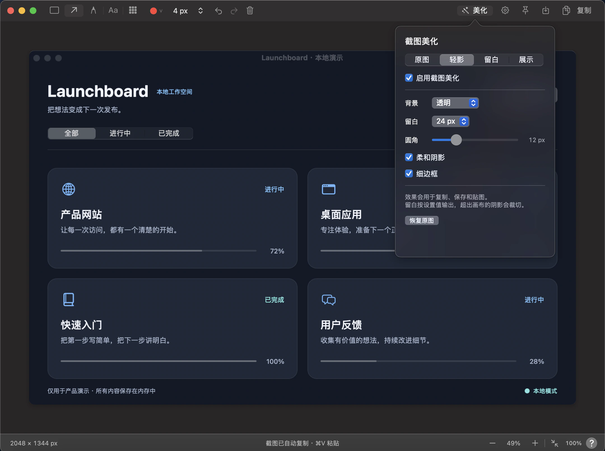

# XShot

English · [简体中文](README.zh-CN.md)

XShot is a native macOS app for screenshots and product demos. Mark up a screenshot before you paste it into a bug report, pin a reference above your work, or turn one recording into a video and a clickable walkthrough.

**[Download XShot for macOS](https://github.com/hijoebon/xshot/releases/latest)**

Apple Silicon · macOS 14 or later · The current app interface is in Simplified Chinese.



## Install and open

1. Download the DMG for Apple Silicon from the latest release. Open it and drag **XShot** into **Applications**.
2. Open XShot from Applications. The download uses an ad hoc signature and has no Apple notarization. If macOS blocks it and you trust the download, try opening it once, then choose **Open Anyway** in **System Settings → Privacy & Security**. [Apple’s first-launch instructions](https://support.apple.com/en-us/102445)
3. When prompted, allow screen recording in **Privacy & Security**. Quit and reopen XShot if capture is still unavailable. To annotate an existing image without granting screen access, open it with **⌘O**.

## Capture, annotate, and pin

- **Capture.** Press **⌥X**. Click a highlighted window, drag to select a region, or press **⌘A** to select the current display. Window captures retain Retina resolution.
- **Annotate.** Add arrows, rectangles, pen strokes, or text from the floating toolbar, or obscure an area with the mosaic brush. Press **V** to select an annotation, then move, resize, or delete it. Double-click text to edit it again.
- **Copy, save, or pin.** Press **⌘C** to copy or **⌘S** to save a PNG. Open the editor (**编辑器**) and use the styling controls (**美化**) to adjust the background, padding, corners, and shadow. Use **贴图** to pin the image above your other windows, or **⌘,** to set your defaults.

## Record a product demo

Press **⌥R**, pick a screen, window, or region, and start recording. Press **⌥P** to pause or resume, then **⌥R** again to finish and edit.

- **Share a video.** Trim the recording, adjust the zoom around key clicks, and export a 60 fps MP4. Recordings are silent.
- **Share a walkthrough.** Edit the generated screenshot steps, add explanations, and set where each hotspot leads. Export a single HTML file that opens offline in a browser. To try it, download the raw HTML file and open it locally. [Example walkthrough](website/demos/release-workflow.html)

XShot saves recordings and editable projects on your Mac, under `~/Movies/XShot/` by default. Reopen a `.xshotdemo` project to continue editing. [Product demo guide in Chinese](Docs/PRODUCT-DEMO.md)

## Keyboard shortcuts

| Shortcut | Action |
| --- | --- |
| ⌥X | Capture a window, region, or display |
| ⌥R | Open demo recording or finish an active recording |
| ⌥P | Pause or resume recording |
| ⌘A | Select the current display during capture |
| V | Select an annotation |
| R / A / P / T / M | Rectangle, arrow, pen, text, or mosaic |
| ⌘C / ⌘S | Copy the screenshot or save a PNG |
| ⌘Z / ⇧⌘Z | Undo or redo |
| ⌘, | Open settings |
| ? | Show the full shortcut list in the screenshot toolbar or editor |

## Build from source

Install the Xcode Command Line Tools, then run these commands from the repository root on an Apple Silicon Mac.

```sh
./scripts/build.sh
open dist/XShot.app
```

## Help and contributing

If you run into a problem, include your macOS and XShot versions, the steps to reproduce it, and the error message if you saw one. [Report an issue](https://github.com/hijoebon/xshot/issues)

XShot is open source under the MIT License. [Contributing guide in Chinese](CONTRIBUTING.md) · [MIT License](LICENSE)
