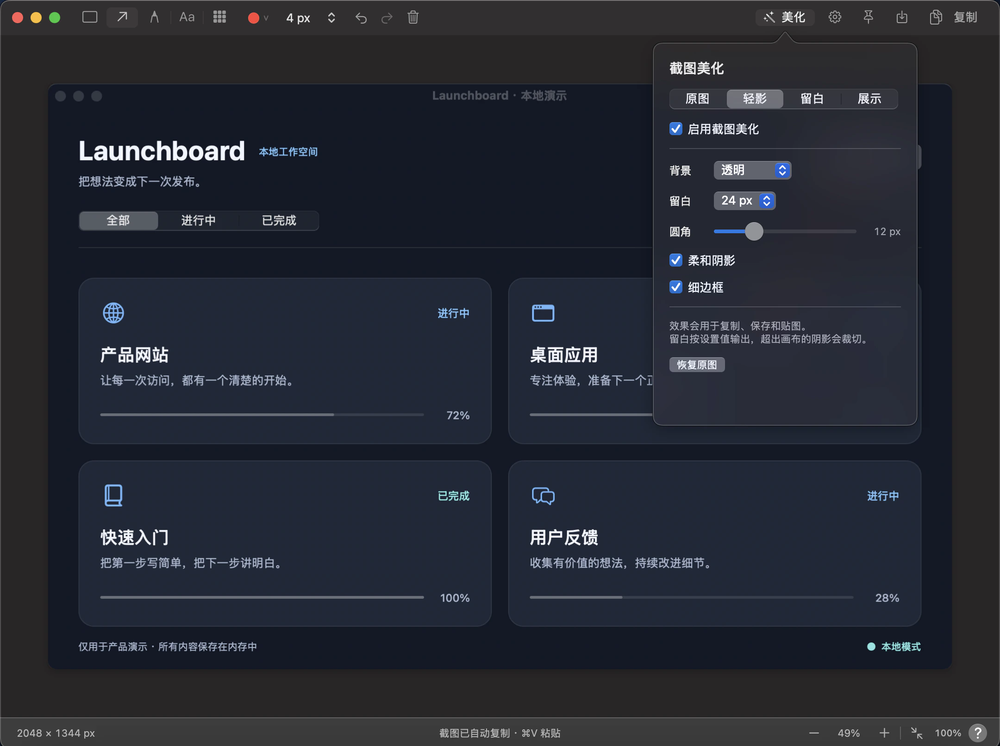

# XShot

[English](README.md) · 简体中文

XShot 是一款 macOS 原生截图和产品演示工具。截图后可以直接标注并粘贴到聊天或文档，也可以把截图贴在其他窗口上方当作参考。录一次操作，就能导出自动聚焦的视频和可点击的离线演示。

**[下载 macOS 版 XShot](https://github.com/hijoebon/xshot/releases/latest)**

需要搭载 Apple 芯片的 Mac 和 macOS 14 或更新版本。当前应用界面为简体中文。



## 安装与首次启动

1. 从最新发行版下载适用于 Apple 芯片的 DMG。打开后，把 **XShot** 拖到「应用程序」。
2. 从「应用程序」打开 XShot。安装包采用临时签名（ad hoc），未经过 Apple 公证。如果 macOS 拦截启动，确认安装包来源后，尝试打开一次，再到「系统设置 → 隐私与安全性」选择「仍要打开」。[Apple 的说明](https://support.apple.com/zh-cn/102445)
3. 第一次截图或录屏时，按提示允许 XShot 访问屏幕。若授权后仍无法采集，请退出并重新打开 XShot。也可以不授权，直接用 **⌘O** 打开已有图片进行标注。

## 截图、标注与贴图

- **截图。** 按 **⌥X**，单击窗口或拖动框选区域。按 **⌘A** 选中当前显示器。窗口截图保留 Retina 像素。
- **标注。** 在截图工具栏画矩形、箭头或笔迹，添加文字，或用马赛克笔刷遮盖局部。按 **V** 可选中已有标注并移动、缩放或删除。双击文字可重新编辑。
- **复制、保存或贴图。** 按 **⌘C** 复制，或按 **⌘S** 保存 PNG。需要调整背景、留白、圆角和阴影时，打开「编辑器」并选择「美化」。点「贴图」可把截图留在其他窗口上方。按 **⌘,** 可调整默认样式和标注设置。

## 录制产品演示

按 **⌥R** 并选择屏幕、窗口或区域。录制时用 **⌥P** 暂停或继续，再按 **⌥R** 完成录制并打开编辑器。

- **导出视频。** 裁去开头和结尾的准备画面，按点击位置自动聚焦，也可手动调整焦点和缩放。成片可导出为 60 fps H.264 MP4。当前录屏不含音频。
- **导出可点击演示。** 编辑步骤截图、标题、说明、热点和跳转目标，再导出一个可离线播放的 HTML 文件。想试试看，可以下载示例的原始 HTML 文件，再用浏览器打开。[可点击演示示例](website/demos/release-workflow.html)

录屏和项目保存在本机，默认目录为 `~/Movies/XShot/`。重新打开 `.xshotdemo` 项目即可继续编辑。[产品演示指南](Docs/PRODUCT-DEMO.md)

## 常用快捷键

| 操作 | 快捷键 |
| --- | --- |
| 截图 | **⌥X** |
| 打开演示录制 / 完成录制 | **⌥R** |
| 暂停 / 继续录制 | **⌥P** |
| 选中当前显示器 | **⌘A**（截图时） |
| 选择标注 | **V** |
| 矩形 / 箭头 / 画笔 / 文字 / 马赛克 | **R / A / P / T / M** |
| 复制 / 保存 PNG | **⌘C / ⌘S** |
| 撤销 / 重做 | **⌘Z / ⇧⌘Z** |
| 设置 | **⌘,** |

在截图界面或编辑器中按 **?**，可查看该界面可用的快捷键。

## 从源码构建

在搭载 Apple 芯片的 Mac 上安装 Xcode Command Line Tools（`xcode-select --install`），然后在仓库根目录运行：

```sh
./scripts/build.sh
open dist/XShot.app
```

## 帮助、贡献与许可证

- 遇到问题时，请附上 XShot 版本、macOS 版本和复现步骤。[提交 Issue](https://github.com/hijoebon/xshot/issues)
- 了解如何构建、验证和提交改动。[贡献指南](CONTRIBUTING.md)
- XShot 使用 MIT 许可证。[许可证全文](LICENSE)
